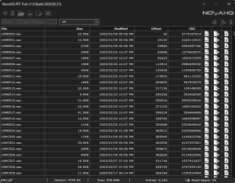
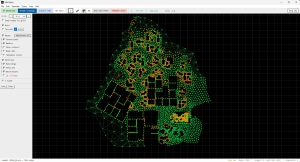
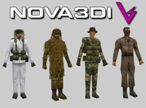
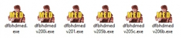
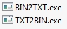
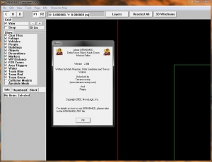
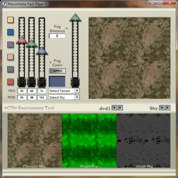
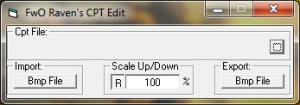
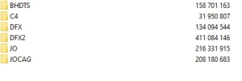
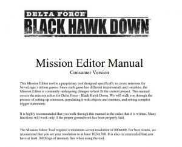

# dfbhdts-projectigi-2
## Delta Force Black Hawk Down Team Sabre - Project IGI 2 Remake
A fan-made remake project recreating Project IGI 2: Covert Strike within Delta Force: Black Hawk Down – Team Sabre, using the BHDTS engine and technology.

## Github Treeview
[https://treegit.macosxjs.com/?url=igiteam/dfbhdts-project-igi-2](https://treegit.macosxjs.com/?url=igiteam/dfbhdts-project-igi-2)

## Github Tree Api Direct JSON
[https://api.github.com/repos/igiteam/dfbhdts-project-igi-2/git/trees/main?recursive=1](https://api.github.com/repos/igiteam/dfbhdts-project-igi-2/git/trees/main?recursive=1)

## Reference Links
[Project IGI 2 README](https://readme.macosxjs.com/?url=https%3A%2F%2Fgithub.com%2Figiteam%2Fdfbhdts-projectigi-2%2Fblob%2Fmain%2Fproject-igi-2%2FREADME.md)

[https://archive.org/download/Nova_DeltaForceBHD-TS_USA/Delta%20Force%20-%20Black%20Hawk%20Down%20%26%20Team%20Sabre%20%28USA%29.7z](https://archive.org/download/Nova_DeltaForceBHD-TS_USA/Delta%20Force%20-%20Black%20Hawk%20Down%20%26%20Team%20Sabre%20%28USA%29.7z)

[https://www.moddb.com/mods/delta-force-team-sabre-operations](https://www.moddb.com/mods/delta-force-team-sabre-operations)

[https://www.moddb.com/games/delta-force-black-hawk-down/mods](https://www.moddb.com/games/delta-force-black-hawk-down/mods)

[https://github.com/igiteam/project-igi-tools](https://github.com/igiteam/project-igi-tools)

[https://novahq.net/files.php?CategoryID=DFBHDTS&Type=File&Game=Black%20Hawk%20Down%20Team%20Sabre](https://novahq.net/files.php?CategoryID=DFBHDTS&Type=File&Game=Black%20Hawk%20Down%20Team%20Sabre)

[https://www.moddb.com/mods/delta-force-black-hawk-down-co-op-campaign-mod](https://www.moddb.com/mods/delta-force-black-hawk-down-co-op-campaign-mod)

[https://www.moddb.com/games/delta-force-black-hawk-down-team-sabre/downloads](https://www.moddb.com/games/delta-force-black-hawk-down-team-sabre/downloads)

[https://www.moddb.com/games/delta-force-black-hawk-down/downloads/environment-tool-2](https://www.moddb.com/games/delta-force-black-hawk-down/downloads/environment-tool-2)

[Novalogic Delta Force Black Hawk Down Team Sabre Editor Tutorials](https://www.youtube.com/playlist?list=PLb8oNKiUbnjFIgoAZQL4m-BRzJegThtUV)

## PROJECT I.G.I 2
[https://github.com/igiteam/dfbhdts-projectigi-2/edit/main/project-igi-2/README.md](https://github.com/igiteam/dfbhdts-projectigi-2/edit/main/project-igi-2/README.md)

[https://archive.org/download/igi-pc-redump/IGI-PC-REDUMP/I.G.I-2%20-%20Covert%20Strike%20%28Europe%29%20%28En%2CFr%2CDe%2CEs%2CIt%29%20%28Disc%201%29.zip](https://archive.org/download/igi-pc-redump/IGI-PC-REDUMP/I.G.I-2%20-%20Covert%20Strike%20%28Europe%29%20%28En%2CFr%2CDe%2CEs%2CIt%29%20%28Disc%201%29.zip)

[https://archive.org/download/igi-pc-redump/IGI-PC-REDUMP/I.G.I-2%20-%20Covert%20Strike%20%28Europe%29%20%28En%2CFr%2CDe%2CEs%2CIt%29%20%28Disc%202%29.zip](https://archive.org/download/igi-pc-redump/IGI-PC-REDUMP/I.G.I-2%20-%20Covert%20Strike%20%28Europe%29%20%28En%2CFr%2CDe%2CEs%2CIt%29%20%28Disc%202%29.zip)

---

## WS11WineCX20.0.4 (macOS Big Sur 32-bit)

[WS11WineCX20.0.4.tar.7z](https://github.com/vitor251093/porting-kit-engines/releases/download/wineskin/WS11WineCX20.0.4.tar.7z)

## Conversion Map

| IGI 2 Format | IGI 2 Role | DFBHDTS Target | DFBHDTS Role | Difficulty | Notes |
|---|---|---|---|---|---|
| `.thm` | Terrain heightmap metadata (quadtree, in `heightmaps.res`) | `.trn` | BHD terrain heightmap | High | BHD `.trn` is a fixed grid with its own height precision. Flatten IGI's quadtree into a uniform heightmap first; the quadtree LOD is discarded. |
| `.tlm` | Full RGBA terrain lightmaps | `.trn` colour map / baked texture | Terrain shading | High | No direct RGBA lightmap slot in BHD `.trn`. Bake into terrain textures, or approximate with vertex colouring. |
| `.tmm` | Terrain material & physics properties | `.trn` material list + `BHD AIN` | Terrain surface types | Medium | Map IGI material IDs to BHD terrain material slots; physics properties (footstep sound, passability) go in the `.trn` material table. |
| `.forest` | Vegetation placement records | `.3di` / `.3do` instances | Static object placement | Medium | Export placement coordinates and object IDs; place as BHD static objects via the MED editor. |
| `.mef` | 3D model geometry | `.3di` / `.3do` | Model geometry | High | Use Nova3di / 3DO converters to get OBJ, then re-import. MEF Type 0/1/3 layouts differ; Type 3 is 28B in IGI 2. Scale conversion needed. |
| `.tex` | Texture cascades | `.dds` / `.tga` in PFF | Textures | Low | Direct image conversion; repack into a PFF archive with NovaPff. |
| `.spr` | Particle sprites | `.dds` with alpha | Textured billboards | Medium | Export as DDS; BHD particle system uses different emitter definitions, so re-author the effects. |
| `.pic` | High-res UI bitmaps | `.dds` / `.tga` | UI textures | Low | Direct image conversion. |
| `.mtp` | Model-texture package | `.3di` + `.dds` | Model material assignment | Medium | Reconstruct material-to-texture mappings in the 3DI/3DO structure. |
| `.olm` | Multi-layer lightmaps | `.3di` vertex lighting / baked | Object lighting | High | No direct slot; rebake object lighting into the 3DI model or export as texture overlays. |
| `.iff` | Skeletal animation | `.bad` | Animation | Very High | BHD/DFX/JO BAD animation format. Must be retargeted or re-authored; no direct IFF→BAD converter. |
| `.dat` | Asset & graph tables | `BHD AIN` / internal | Asset lookup / AI | Very High | `graphs.dat` (0xFFEEDDCC signature, 10 tagged node fields) has no BHD equivalent; AI pathing is engine-internal. Rebuild as AIN or waypoints. |
| `.qvm` / `.qsc` | Script bytecode / source | `BHD MED` / `BIN` scripts | Mission scripting | Very High | QVM opcodes have no mapping to BHD's mission system. Scripts must be rewritten, not converted. |
| `.syn` | Synchronization timelines | `BHD MED` events | Timed mission events | High | Re-author sync events in the MED mission editor; no timeline file format to convert. |
| `.fnt` | Multi-lingual font atlas | `.dds` atlas + BHD font def | UI text | Medium | Remap glyphs to BHD's font system; the atlas itself converts as an image. |
| `.wav` | Innerloop audio samples | `.wav` / `.ogg` in PFF | Audio | Low | Resample to BHD's expected rate (typically 22050 Hz, 16-bit mono) and repack. |
| `.mp3` / `.bmp` / `.jpg` | Modern media formats | `.wav` / `.dds` | Audio / textures | Low | Convert directly; repack into PFF. |
| `.res` | Resource archive | `.pff` | Asset archive | Medium | Repack converted assets into a PFF archive via NovaPff. |

## IGI 2 Format Specification Links

Base URL: [https://project-igi-research.vercel.app/igi2](https://project-igi-research.vercel.app/igi2)

| Format | Name | Engine Role | Specification |
|---|---|---|---|
| `.qvm` | QVM | Script Bytecode | [View Specification](https://project-igi-research.vercel.app/igi2/qvm) |
| `.qsc` | QSC | Script Source Language | [View Specification](https://project-igi-research.vercel.app/igi2/qsc) |
| `.res` | RES | Resource Archive | [View Specification](https://project-igi-research.vercel.app/igi2/res) |
| `.mef` | MEF | 3D Model Geometry | [View Specification](https://project-igi-research.vercel.app/igi2/mef) |
| `.tex` | TEX | Texture Cascades | [View Specification](https://project-igi-research.vercel.app/igi2/tex) |
| `.spr` | SPR | Particle Sprites | [View Specification](https://project-igi-research.vercel.app/igi2/spr) |
| `.pic` | PIC | High-Res UI Bitmaps | [View Specification](https://project-igi-research.vercel.app/igi2/pic) |
| `.mtp` | MTP | Model-Texture Package | [View Specification](https://project-igi-research.vercel.app/igi2/mtp) |
| `.dat` | DAT | Asset & Graph Tables | [View Specification](https://project-igi-research.vercel.app/igi2/dat) |
| `.fnt` | FNT | Multi-Lingual Font Atlas | [View Specification](https://project-igi-research.vercel.app/igi2/fnt) |
| `.iff` | IFF | Skeletal Animation | [View Specification](https://project-igi-research.vercel.app/igi2/iff) |
| `.olm` | OLM | Multi-Layer Lightmaps | [View Specification](https://project-igi-research.vercel.app/igi2/olm) |
| `.thm` | THM | Terrain Heightmap Metadata | [View Specification](https://project-igi-research.vercel.app/igi2/thm) |
| `.tlm` | TLM | Full RGBA Terrain Lightmaps | [View Specification](https://project-igi-research.vercel.app/igi2/tlm) |
| `.tmm` | TMM | Terrain Material Physics | [View Specification](https://project-igi-research.vercel.app/igi2/tmm) |
| `.forest` | Forest | Vegetation Placements | [View Specification](https://project-igi-research.vercel.app/igi2/forest) |
| `.syn` | SYN | Synchronization Timelines | [View Specification](https://project-igi-research.vercel.app/igi2/syn) |
| `.wav` | WAV | Innerloop Audio Samples | [View Specification](https://project-igi-research.vercel.app/igi2/wav) |
| `.mp3` / `.bmp` / `.jpg` | MP3/BMP/JPG | Modern Media Formats | [View Specification](https://project-igi-research.vercel.app/igi2/mp3-bmp-jpg) |

---

## Key Conversion Constraints

1. **Terrain is the hardest bottleneck.** IGI 2's `.thm` quadtree heightmap must be flattened into BHD's fixed-grid `.trn`. The quadtree LOD and IGI's terrain partitioning (`.tmm`) are lost; BHD terrain will be simpler but will load and render in the BHDTS engine.

2. **Models must go through Nova3di.** There is no direct MEF-to-3DI converter. Export MEF to OBJ (via the converter repo's parsers), then import into BHD's 3DI/3DO format. Note the IGI 2 Type 3 MEF record is 28B (not 40B as in IGI 1) — confirm against retail samples before batch conversion.

3. **Scripts and AI are not convertible.** QVM bytecode has no mapping to BHD's MED mission system. The `graphs.dat` AI navigation graph has no file-level counterpart. These must be reimplemented — which is why this is a total conversion, not a port.

4. **Use the NovaLogic tools.** NovaPff (PFF archives), Nova3di (3DI/3DO/PAK → OBJ), BHD AIN Editor, BHD MED, and BIN2TXT/TXT2BIN are the practical pipeline. The mod tools pack handles the official toolchain.

5. **Audio and textures are the easy wins.** `.tex` → DDS, `.wav` → 22050 Hz mono, `.pic` → DDS. These convert directly and should be done first to validate the pipeline before tackling terrain and models.

---

## Reference Links

- NovaLogic PFF Editor / Extractor (NovaPff, 4GB support)
- NovaLogic 3DI / 3DO / PAK → OBJ Converter (Nova3di)
- BHD AIN Editor
- BHD / BHDTS MED Mission Editor Collection
- Black Hawk Down Official Mod Tools
- BHD Bin Tools (BIN2TXT / TXT2BIN)
- BHD MED Mission Editor v2.00i
- BHD Environment & Terrain Viewer
- Black Hawk Down FwO Raven CPT Edit BMP
- BHD/DFX/JO BAD Animation Files
- BHD Mission Editor Manual

---

## Dev Environment

**Official White Wii Remote With Nunchuk — Tested And Working — £14.99**
[https://www.ebay.co.uk/itm/800847189353](https://www.ebay.co.uk/itm/800847189353)

**Infrared Sensor Bar USB for Wii Emulator Remote Motion Detection Setup — £6.69**
[https://www.ebay.co.uk/itm/227423830875](https://www.ebay.co.uk/itm/227423830875)

**Apple MacBook Pro Retina 15in (2014) i7 2.8GHz 16GB 1TB SSD GT 750M — £120.30**
[https://www.ebay.co.uk/itm/800844561513](https://www.ebay.co.uk/itm/800844561513)

**WS11WineCX20.0.4 (Wine engine)**
[https://igiteam.github.io/wine_engines/](https://igiteam.github.io/wine_engines/)

**Official Genuine Sony PS3 PlayStation 3 DualShock 3 Wireless Controller Black — £19.99**
[https://www.ebay.co.uk/itm/840031043465](https://www.ebay.co.uk/itm/840031043465)

**Amazon Basics 4K HDMI Cable 3m — 18Gbps High Speed with Ethernet, 4K@60Hz, 2160p — £8.44**
[https://www.ebay.co.uk/itm/327352257557](https://www.ebay.co.uk/itm/327352257557)

**wiimote_nunchuk_macosx**
[https://github.com/igiteam/wiimote-nunchuk](https://github.com/igiteam/wiimote-nunchuk)

**xbox360_input_gui_py**
[https://github.com/igiteam/xbox360_input_gui_py](https://github.com/igiteam/xbox360_input_gui_py)

**logitec_mx_mouse_3_macos**
[https://github.com/igiteam/logitec_mx_mouse_3_macos](https://github.com/igiteam/logitec_mx_mouse_3_macos)

**igi1-macbook-3d-workstation**
[https://github.com/igiteam/igi1-macbook-3d-workstation](https://github.com/igiteam/igi1-macbook-3d-workstation)

---

