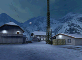
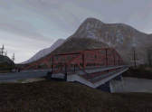
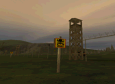

# IGI 2: Covert Strike — Missions

Every briefing and objective, exactly as the game lists them.

[IGI 2: Covert Strike — 19 Missions](https://playigi.com/missions.html#igi2)

---

# Campaign 1

## Mission 01 / 19 — Infiltration

1. Infiltrate main compound.
2. Cross the river to gain access to upper compound.
3. Activate, and use lift down to mines.

---

## Mission 02 / 19 — Deep in the Mines

1. Gain access to lower cave system.
2. Disable security system.
3. Open doors to tunnel.
4. Ride the train to the ventilation shaft.
5. Use ventilation shaft to gain access to the weather station.

---

## Mission 03 / 19 — The Weather Station

1. Pick up laser cutter from airdrop.
2. Steal papers from the safe.
3. Disable the security system and override the airlock to get access to lab.
4. Steal prototype EMP chip from the lab.
5. Raise the weather balloon and await evacuation.

---

## Mission 04 / 19 — Bridge Across the Dnestr

1. Infiltrate the warehouse, and acquire four C4 charges.
2. Acquire the timers and fuses from a patrol near the bridge.
3. Set a C4 charge on each one of the four supporting pillars of the bridge.
4. Get to safety before the bridge explodes, on the side of the river where the convoy is.

---

## Mission 05 / 19 — Ambush

1. Destroy the APC using the rocket launcher found in the convoy.
2. Pick up the EMP chips from the trucks in the convoy.
3. Resist the enemies forces, kill them all.
4. Await the helicopter for evacuation.

---

## Mission 06 / 19 — Production Facility

1. Disable the security cameras.
2. Steal the blueprints for the EMP chips.
3. Turn off the power for the electrical fences.
4. Turn on the power for the factory machinery.
5. Hack the computer controlling the assembly line machinery.
6. Get to the helicopter for evacuation.

---

## Mission 07 / 19 — Border Crossing

1. Ambush Communications vehicle guards.
2. Send radio signal for rescue helicopter.
3. Move to extraction zone.

---

# Campaign 2

## Mission 08 / 19 — Libyan Rendezvous

1. Meet the bribed local militia man to be guided to the surveilance room.
2. Shut down the surveillance cameras for the hotel.
3. Pick up explosive charge.
4. Blow up refueling vehicle in the market place.
5. Neutralise the intelligence operatives guarding Priboi.
6. Get to the hotel and rescue Priboi.

---

## Mission 09 / 19 — Prison Escape

1. Escape from your cell.
2. Get your map computer and lockpicks back.
3. Locate Priboi in main prison building.
4. Get to the security control building and hack the terminal to reconfigure prison building security system.
5. Open the gates to the inner and outer yards, and the main gates.
6. Take down the two guards covering the gate by the prison, and continue to provide covering sniper fire for Priboi as he makes a dash for the getaway truck.

---

## Mission 10 / 19 — Priboi's Villa

1. Take Backup of Priboi's computer records.
2. Pick up the envelope located in the safe in Priboi's bedroom.
3. Get out of there in Priboi's Limousine, located in the garage compound.

---

## Mission 11 / 19 — The Airfield

1. Infiltrate Compound.
2. Sabotage Radio.
3. Acquire amunition for helicopter's gun.
4. Power up fuel pumps.
5. Activate fuel pump.

---

## Mission 12 / 19 — Zaleb's Stronghold

1. Eliminate the enemies heading for the radio station before they warn of your arrival.
2. Get Priboi's Briefcase, and eliminate Zaleb.
3. Get back to the helicopter with the briefcase.

---

## Mission 13 / 19 — Showdown at the Docks

1. Search database for information on secure area.
2. Turn on power to crane.
3. Destroy secure compound wall.
4. Search offices in secure warehouse.
5. Confront Robert Quest and Chinese soldiers.
6. Get aboard the Ekranoplane.

---

# Campaign 3

## Mission 14 / 19 — Island Assault

1. Turn off the power supply for the radar facility.
2. Disable radar terminal.
3. Disable communications terminal.

---

## Mission 15 / 19 — Air-Strike

1. Get in range and tag 1st SAM launcher.
2. Get in range of 2nd SAM launcher before friendly fighter is shot down.
3. Tag 2nd SAM launcher.
4. Move to drop zone and collect equipment canister.

---

## Mission 16 / 19 — The Ancient Temple

1. Neutralise enemy snipers.
2. Gain access to main gatehouse.
3. Disable security cameras.
4. Re-align satellite dish.
5. Gain access to main temple building.

---

## Mission 17 / 19 — Secret Weapons Lab

1. Get blueprints of laboratory.
2. Customise transmitter.
3. Upload data on EMP weapons.
4. Defeat Wu Xing and his squad of elite troops.

---

## Mission 18 / 19 — Mission Control

1. Sabotage radar control.
2. Call for repairs.
3. Gain access to launch control compound.
4. Acquire launch codes.
5. Reprogram navigational computer.
6. Override launch control.
7. Slide down the wire to the launch pad.

---

## Mission 19 / 19 — The Launch Pad

1. Shut off rocket fuelling process.
2. Place tracking device inside the rocket.
3. Move the gantry.
4. Seal off the launch bunker.
5. Initiate rocket launch.

---

*IGI 2: Covert Strike © Innerloop Studios / Codemasters, 2003.*
