# IGI 2: Covert Strike — Missions, Campaigns and Changes from IGI 1

IGI 2: Covert Strike, the sequel to Project I.G.I., has 19 missions split into three campaigns: seven in the first, six in the second and six in the third. It runs from "Infiltration" to "The Launch Pad". Below is every mission with its objectives as the game lists them and what changed from IGI 1.

*Campaign 1, mission 1: Infiltration. The first job is getting inside the main compound.*

## The three campaigns at a glance

| Campaign | Missions | First mission | Last mission | Objectives |
| :--- | :--- | :--- | :--- | :--- |
| 1 | 7 | Infiltration | Border Crossing | 30 |
| 2 | 6 | Libyan Rendezvous | Showdown at the Docks | 29 |
| 3 | 6 | Island Assault | The Launch Pad | 28 |

That is 87 objectives across the game. For comparison, the first game's 14 missions have 47 objective lines in their text files, of which the map computer shows 37. A typical IGI 2 mission gives you three to six tasks, and the longest, Mission Control, has seven.

## Campaign 1: the EMP chip trail

The first campaign follows a trail of EMP technology: a prototype chip you steal from a lab, the trucks that carry more of them and the factory that builds them. It goes from a compound down into the mines and ends at a border.

1. **Infiltration.** Get into the main compound, cross the river to the upper compound, then activate the lift and ride it down to the mines.
2. **Deep in the Mines.** Reach the lower caves, disable the security system, open the tunnel doors, ride the train to the ventilation shaft and climb it into the weather station.
3. **The Weather Station.** Collect a laser cutter from an airdrop, steal papers from a safe, disable security and override the airlock into the lab, take the prototype EMP chip, then raise the weather balloon and wait for evacuation.
4. **Bridge Across the Dnestr.** Take four C4 charges from a warehouse, get the timers and fuses from a patrol near the bridge, set one charge on each of the four pillars, and get clear on the side of the river where the convoy is.
5. **Ambush.** Destroy the APC with the rocket launcher found in the convoy, pick up the EMP chips from the trucks, kill the enemy forces that come for you and wait for the helicopter.
6. **Production Facility.** Disable the cameras, steal the EMP chip blueprints, cut the power to the electric fences, turn on the factory machinery, hack the assembly line computer and reach the helicopter.
7. **Border Crossing.** Ambush the guards of a communications vehicle, send a radio signal for a rescue helicopter and move to the extraction zone.

Missions 4 and 5 read as a pair: you blow the bridge in one, then hit the convoy and its chips in the next. In Bridge Across the Dnestr the C4 comes from a warehouse, but the timers and fuses come from a patrol near the bridge, so there are two stops before the pillars.

## Campaign 2: Priboi, Zaleb and Robert Quest

The second campaign brings back the Priboi name from IGI 1. You rescue Priboi from a hotel in Libya, start the next mission in a prison cell, break him out and then go through his villa.

8. **Libyan Rendezvous.** Meet a bribed militia man who guides you to the surveillance room, shut down the hotel cameras, pick up an explosive charge, blow up a refuelling vehicle in the market place, take out the intelligence operatives guarding Priboi and rescue him from the hotel.
9. **Prison Escape.** Escape your cell, get your map computer and lockpicks back, find Priboi in the main prison building, hack the security terminal, open the gates of the inner and outer yards and the main gate, then take down the two gate guards and give sniper cover while Priboi runs for the getaway truck.
10. **Priboi's Villa.** Back up Priboi's computer records, take the envelope from the safe in his bedroom and leave in his limousine from the garage compound.
11. **The Airfield.** Get into the compound, sabotage the radio, find ammunition for the helicopter's gun, power up the fuel pumps and switch one on.
12. **Zaleb's Stronghold.** Stop the enemies heading for the radio station before they warn of your arrival, get Priboi's briefcase, eliminate Zaleb and return to the helicopter with the case.
13. **Showdown at the Docks.** Search a database for the secure area, power the crane, destroy the secure compound wall, search the offices in the secure warehouse, confront Robert Quest and Chinese soldiers, then get aboard the Ekranoplane.

Prison Escape starts in a cell, and getting your map computer and lockpicks back is an objective in its own right. Zaleb's Stronghold puts pressure on you from the start, because the first objective is to stop the warning reaching the radio station.

## Campaign 3: the island, the temple and the rocket

The last campaign moves from an island radar site to a temple, a weapons lab and finally a rocket launch.

14. **Island Assault.** Turn off the power to the radar facility, then disable the radar terminal and the communications terminal.
15. **Air-Strike.** Get in range and tag the first SAM launcher, reach the second before a friendly fighter is shot down and tag it too, then collect an equipment canister at the drop zone.
16. **The Ancient Temple.** Neutralise the enemy snipers, get into the main gatehouse, disable the cameras, re-align a satellite dish and get into the main temple building.
17. **Secret Weapons Lab.** Get the lab blueprints, customise a transmitter, upload the data on EMP weapons and defeat Wu Xing and his elite squad.
18. **Mission Control.** Sabotage radar control, call for repairs, get into the launch control compound, acquire the launch codes, reprogram the navigation computer, override launch control and slide down the wire to the launch pad.
19. **The Launch Pad.** Shut off the rocket fuelling, place a tracking device inside the rocket, move the gantry, seal the launch bunker and start the launch.

*Mission 19, The Launch Pad: the last objective is to start the rocket launch yourself.*

Air-Strike runs against the clock: the second SAM launcher has to be reached before the friendly fighter goes down, so do not linger after the first tag. Mission Control has an odd step, "Call for repairs", right after you sabotage the radar.

## What changed from IGI 1

The shape of IGI 2 is familiar: large bases, cameras, alarms and a helicopter at the end. The main differences:

- **Size.** IGI 1 has one campaign of 14 missions. IGI 2 has three campaigns and 19 missions, with more than twice as many objectives as the first game's map computer shows.
- **Priboi's role.** In IGI 1 you rescue Josef Priboi, then kidnap Jach Priboi in "Get Priboi" and later defend him. In IGI 2 the Priboi name returns: you rescue him in Libya, break him out of prison, cover his run to a getaway truck and then go through his villa.
- **Gear named in the objectives.** The map computer and C4 are back. IGI 2's objectives also name a laser cutter, lockpicks, a rocket launcher, a transmitter you customise and a tracking device.
- **Getting around.** A mine lift, a tunnel train, a limousine, a slide down a wire and the Ekranoplane all appear in the objectives.
- **Familiar names.** Both games have a mission called Border Crossing, both make you deal with SAM launchers, and both send you to a warehouse for C4 charges before a demolition job.

# IGI 2: Covert Strike — Missions

Every briefing and objective, exactly as the game lists them.

[IGI 2: Covert Strike — 19 Missions](https://playigi.com/missions.html#igi2)

---

# Campaign 1

## Mission 01 / 19 — Infiltration

[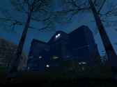](https://raw.githubusercontent.com/igiteam/dfbhdts-projectigi-2/refs/heads/main/project-igi-2/igi2-m11.png)

1. Infiltrate main compound.
2. Cross the river to gain access to upper compound.
3. Activate, and use lift down to mines.

---

## Mission 02 / 19 — Deep in the Mines

[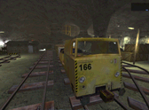](https://raw.githubusercontent.com/igiteam/dfbhdts-projectigi-2/refs/heads/main/project-igi-2/igi2-m12.png)

1. Gain access to lower cave system.
2. Disable security system.
3. Open doors to tunnel.
4. Ride the train to the ventilation shaft.
5. Use ventilation shaft to gain access to the weather station.

---

## Mission 03 / 19 — The Weather Station

1. Pick up laser cutter from airdrop.
2. Steal papers from the safe.
3. Disable the security system and override the airlock to get access to lab.
4. Steal prototype EMP chip from the lab.
5. Raise the weather balloon and await evacuation.

---

## Mission 04 / 19 — Bridge Across the Dnestr

1. Infiltrate the warehouse, and acquire four C4 charges.
2. Acquire the timers and fuses from a patrol near the bridge.
3. Set a C4 charge on each one of the four supporting pillars of the bridge.
4. Get to safety before the bridge explodes, on the side of the river where the convoy is.

---

## Mission 05 / 19 — Ambush

[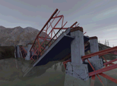](https://raw.githubusercontent.com/igiteam/dfbhdts-projectigi-2/refs/heads/main/project-igi-2/igi2-m15.png)

1. Destroy the APC using the rocket launcher found in the convoy.
2. Pick up the EMP chips from the trucks in the convoy.
3. Resist the enemies forces, kill them all.
4. Await the helicopter for evacuation.

---

## Mission 06 / 19 — Production Facility

[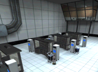](https://raw.githubusercontent.com/igiteam/dfbhdts-projectigi-2/refs/heads/main/project-igi-2/igi2-m16.png)

1. Disable the security cameras.
2. Steal the blueprints for the EMP chips.
3. Turn off the power for the electrical fences.
4. Turn on the power for the factory machinery.
5. Hack the computer controlling the assembly line machinery.
6. Get to the helicopter for evacuation.

---

## Mission 07 / 19 — Border Crossing

1. Ambush Communications vehicle guards.
2. Send radio signal for rescue helicopter.
3. Move to extraction zone.

---

# Campaign 2

## Mission 08 / 19 — Libyan Rendezvous

[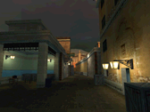](https://raw.githubusercontent.com/igiteam/dfbhdts-projectigi-2/refs/heads/main/project-igi-2/igi2-m21.png)

1. Meet the bribed local militia man to be guided to the surveilance room.
2. Shut down the surveillance cameras for the hotel.
3. Pick up explosive charge.
4. Blow up refueling vehicle in the market place.
5. Neutralise the intelligence operatives guarding Priboi.
6. Get to the hotel and rescue Priboi.

---

## Mission 09 / 19 — Prison Escape

[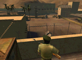](https://raw.githubusercontent.com/igiteam/dfbhdts-projectigi-2/refs/heads/main/project-igi-2/igi2-m22.png)

1. Escape from your cell.
2. Get your map computer and lockpicks back.
3. Locate Priboi in main prison building.
4. Get to the security control building and hack the terminal to reconfigure prison building security system.
5. Open the gates to the inner and outer yards, and the main gates.
6. Take down the two guards covering the gate by the prison, and continue to provide covering sniper fire for Priboi as he makes a dash for the getaway truck.

---

## Mission 10 / 19 — Priboi's Villa

[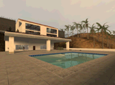](https://raw.githubusercontent.com/igiteam/dfbhdts-projectigi-2/refs/heads/main/project-igi-2/igi2-m23.png)

1. Take Backup of Priboi's computer records.
2. Pick up the envelope located in the safe in Priboi's bedroom.
3. Get out of there in Priboi's Limousine, located in the garage compound.

---

## Mission 11 / 19 — The Airfield

[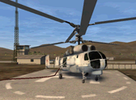](https://raw.githubusercontent.com/igiteam/dfbhdts-projectigi-2/refs/heads/main/project-igi-2/igi2-m24.png)

1. Infiltrate Compound.
2. Sabotage Radio.
3. Acquire amunition for helicopter's gun.
4. Power up fuel pumps.
5. Activate fuel pump.

---

## Mission 12 / 19 — Zaleb's Stronghold

[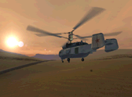](https://raw.githubusercontent.com/igiteam/dfbhdts-projectigi-2/refs/heads/main/project-igi-2/igi2-m25.png)

1. Eliminate the enemies heading for the radio station before they warn of your arrival.
2. Get Priboi's Briefcase, and eliminate Zaleb.
3. Get back to the helicopter with the briefcase.

---

## Mission 13 / 19 — Showdown at the Docks

[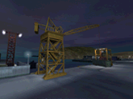](https://raw.githubusercontent.com/igiteam/dfbhdts-projectigi-2/refs/heads/main/project-igi-2/igi2-m26.png)

1. Search database for information on secure area.
2. Turn on power to crane.
3. Destroy secure compound wall.
4. Search offices in secure warehouse.
5. Confront Robert Quest and Chinese soldiers.
6. Get aboard the Ekranoplane.

---

# Campaign 3

## Mission 14 / 19 — Island Assault

[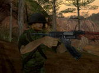](https://raw.githubusercontent.com/igiteam/dfbhdts-projectigi-2/refs/heads/main/project-igi-2/igi2-m31.png)

1. Turn off the power supply for the radar facility.
2. Disable radar terminal.
3. Disable communications terminal.

---

## Mission 15 / 19 — Air-Strike

[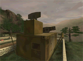](https://raw.githubusercontent.com/igiteam/dfbhdts-projectigi-2/refs/heads/main/project-igi-2/igi2-m32.png)

1. Get in range and tag 1st SAM launcher.
2. Get in range of 2nd SAM launcher before friendly fighter is shot down.
3. Tag 2nd SAM launcher.
4. Move to drop zone and collect equipment canister.

---

## Mission 16 / 19 — The Ancient Temple

[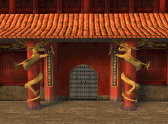](https://raw.githubusercontent.com/igiteam/dfbhdts-projectigi-2/refs/heads/main/project-igi-2/igi2-m33.png)

1. Neutralise enemy snipers.
2. Gain access to main gatehouse.
3. Disable security cameras.
4. Re-align satellite dish.
5. Gain access to main temple building.

---

## Mission 17 / 19 — Secret Weapons Lab

[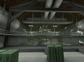](https://raw.githubusercontent.com/igiteam/dfbhdts-projectigi-2/refs/heads/main/project-igi-2/igi2-m34.png)

1. Get blueprints of laboratory.
2. Customise transmitter.
3. Upload data on EMP weapons.
4. Defeat Wu Xing and his squad of elite troops.

---

## Mission 18 / 19 — Mission Control

[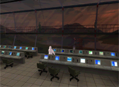](https://raw.githubusercontent.com/igiteam/dfbhdts-projectigi-2/refs/heads/main/project-igi-2/igi2-m35.png)

1. Sabotage radar control.
2. Call for repairs.
3. Gain access to launch control compound.
4. Acquire launch codes.
5. Reprogram navigational computer.
6. Override launch control.
7. Slide down the wire to the launch pad.

---

## Mission 19 / 19 — The Launch Pad

[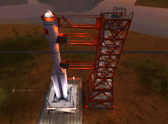](https://raw.githubusercontent.com/igiteam/dfbhdts-projectigi-2/refs/heads/main/project-igi-2/igi2-m36.png)

1. Shut off rocket fuelling process.
2. Place tracking device inside the rocket.
3. Move the gantry.
4. Seal off the launch bunker.
5. Initiate rocket launch.

---

*IGI 2: Covert Strike © Innerloop Studios / Codemasters, 2003.*
